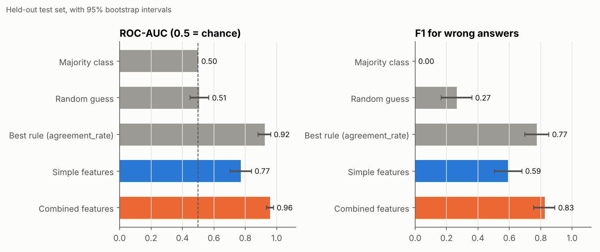
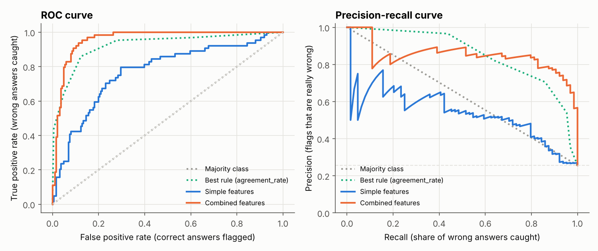
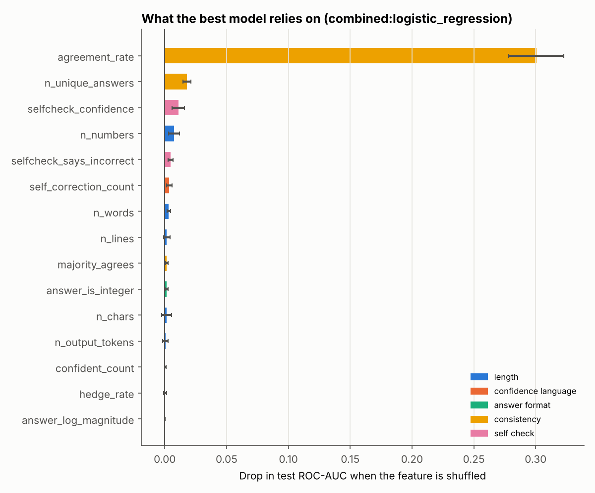
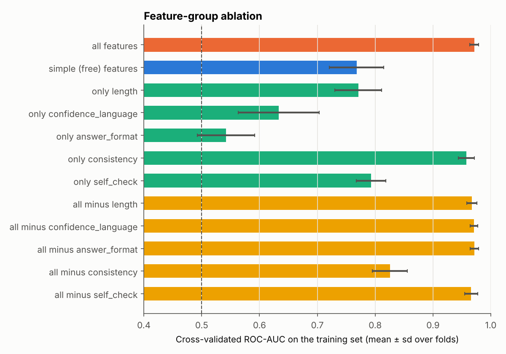
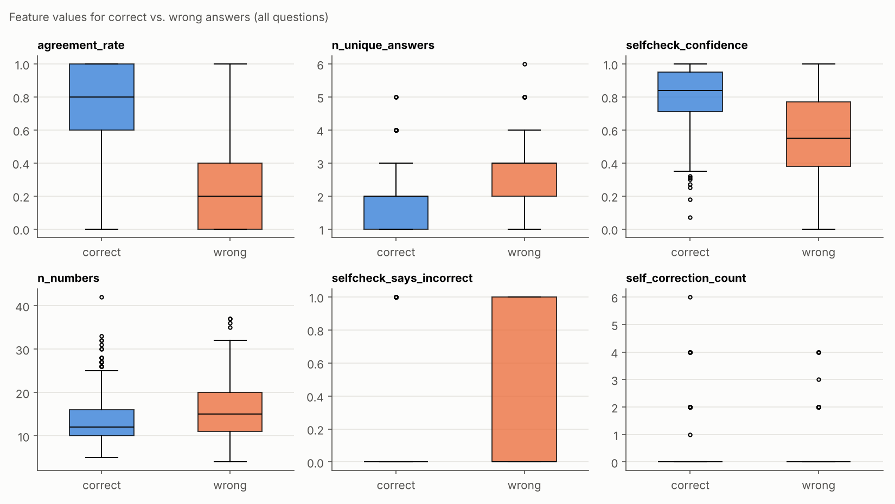
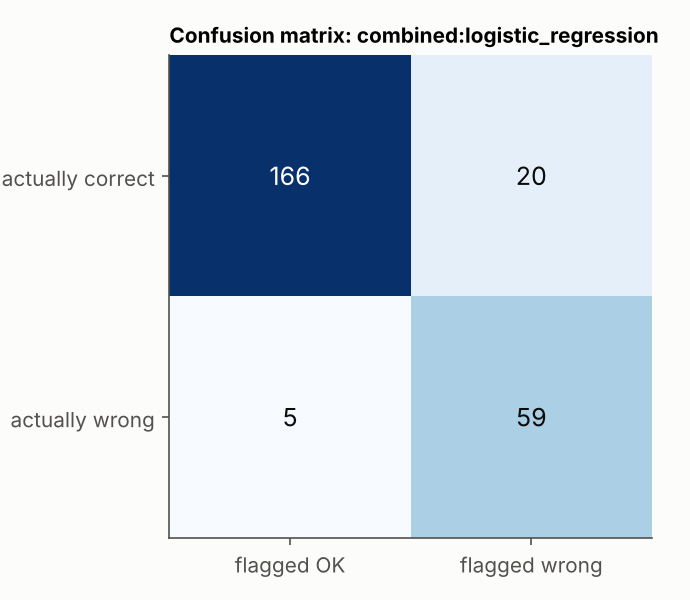

# Results: demo

> **Warning: simulated data.** These responses come from the built-in *fake* LLM,
> whose errors were generated so that the features carry signal. The numbers below
> show that the pipeline works; they say nothing about real LLMs.
> Run `configs/claude.yaml` or `configs/ollama.yaml` for real results.

## Setup

- **Model:** `simulated` / `simulated-llm`
- **Dataset:** `data/raw/gsm8k_test.jsonl` — 1000 questions
- **Model error rate:** 25.5% (255 wrong answers)
- **Split:** 750 train / 250 test (64 wrong answers in test), 5-fold CV on train, seed 42
- **Extra samples per question (consistency):** 5; **self-check:** on

## Answer to the research question

*Can simple features from an LLM response help predict whether the answer is wrong?*

- Combined features (`combined:logistic_regression`) better than chance? **yes** — test ROC-AUC 0.959 vs. 0.5 (permutation p = 0.0010).
- Free single-response features only (`simple:logistic_regression`) better than chance? **yes** — test ROC-AUC 0.771 (p = 0.0010).
- Combined better than simple? **yes** — AUC difference +0.187, 95% CI [+0.121, +0.253] (bootstrap p = 0.0020).
- Combined model better than the best single rule (`rule:agreement_rate`)? **yes** — AUC difference +0.035, 95% CI [+0.005, +0.070] (bootstrap p = 0.0160).

How to read this: ROC-AUC is the probability that a randomly chosen wrong answer gets a
higher "risk" score than a randomly chosen correct one (0.5 = coin flip, 1.0 = perfect).
Models were chosen by cross-validation on the training set, so the test numbers are honest.

## Test-set results (95% bootstrap CIs)

| model | kind | ROC-AUC | PR-AUC | accuracy | balanced acc. | precision (wrong) | recall (wrong) | F1 (wrong) |
|---|---|---|---|---|---|---|---|---|
| majority | baseline | 0.500 [0.500, 0.500] | 0.256 | 0.744 | 0.500 [0.500, 0.500] | 0.000 | 0.000 | 0.000 [0.000, 0.000] |
| random | baseline | 0.506 [0.448, 0.568] | 0.259 | 0.624 | 0.506 [0.448, 0.568] | 0.266 | 0.266 | 0.266 [0.167, 0.362] |
| rule:agreement_rate | baseline | 0.924 [0.881, 0.962] | 0.807 | 0.872 | 0.868 [0.821, 0.916] | 0.705 | 0.859 | 0.775 [0.698, 0.852] |
| rule:selfcheck_says_incorrect | baseline | 0.730 [0.667, 0.798] | 0.480 | 0.812 | 0.730 [0.667, 0.798] | 0.655 | 0.562 | 0.605 [0.495, 0.707] |
| rule:selfcheck_confidence | baseline | 0.793 [0.723, 0.861] | 0.656 | 0.804 | 0.730 [0.659, 0.795] | 0.627 | 0.578 | 0.602 [0.487, 0.696] |
| rule:hedge_rate | baseline | 0.568 [0.500, 0.639] | 0.285 | 0.256 | 0.500 [0.500, 0.500] | 0.256 | 1.000 | 0.408 [0.333, 0.471] |
| rule:n_words | baseline | 0.680 [0.608, 0.757] | 0.384 | 0.636 | 0.632 [0.561, 0.704] | 0.374 | 0.625 | 0.468 [0.374, 0.565] |
| simple:logistic_regression | simple | 0.771 [0.703, 0.840] | 0.543 | 0.752 | 0.736 [0.675, 0.796] | 0.511 | 0.703 | 0.592 [0.504, 0.681] |
| simple:random_forest | simple | 0.763 [0.697, 0.828] | 0.484 | 0.752 | 0.623 [0.563, 0.693] | 0.523 | 0.359 | 0.426 [0.306, 0.545] |
| simple:gradient_boosting | simple | 0.730 [0.663, 0.799] | 0.464 | 0.708 | 0.640 [0.575, 0.715] | 0.438 | 0.500 | 0.467 [0.362, 0.567] |
| combined:logistic_regression | combined | 0.959 [0.935, 0.980] | 0.849 | 0.900 | 0.907 [0.865, 0.947] | 0.747 | 0.922 | 0.825 [0.755, 0.891] |
| combined:random_forest | combined | 0.964 [0.941, 0.982] | 0.883 | 0.896 | 0.869 [0.812, 0.920] | 0.788 | 0.812 | 0.800 [0.718, 0.871] |
| combined:gradient_boosting | combined | 0.965 [0.944, 0.983] | 0.886 | 0.896 | 0.869 [0.816, 0.920] | 0.788 | 0.812 | 0.800 [0.720, 0.872] |

PR-AUC's chance level equals the error rate (0.255). The majority baseline's
accuracy shows why accuracy alone is misleading: it never flags anything.

## Which features matter?

Permutation importance on the test set (how much ROC-AUC drops when a feature is shuffled):

| feature | group | importance_mean | importance_std | description |
|---|---|---|---|---|
| agreement_rate | consistency | 0.301 | 0.022 | Share of extra samples whose answer equals the main answer |
| n_unique_answers | consistency | 0.018 | 0.003 | Distinct answers across main + extra samples |
| selfcheck_confidence | self_check | 0.011 | 0.005 | Model's stated confidence (0-1) that its answer is correct |
| n_numbers | length | 0.007 | 0.004 | Numbers written in the response |
| selfcheck_says_incorrect | self_check | 0.005 | 0.002 | 1 if the model judged its own answer INCORRECT |
| self_correction_count | confidence_language | 0.004 | 0.002 | Self-correction phrases ('wait', 'actually', 'mistake', ...) |
| n_words | length | 0.003 | 0.001 | Words in the response |
| n_lines | length | 0.002 | 0.002 | Non-empty lines (roughly, reasoning steps) |
| majority_agrees | consistency | 0.002 | 0.001 | 1 if the main answer is the most common answer across samples |
| answer_is_integer | answer_format | 0.001 | 0.001 | 1 if the final answer is a whole number (GSM8K answers always are) |

Feature-group ablation (cross-validated on the training set):

| setting | n_features | roc_auc_mean | roc_auc_std | f1_wrong_mean |
|---|---|---|---|---|
| all features | 21 | 0.971 | 0.008 | 0.834 |
| simple (free) features | 15 | 0.768 | 0.047 | 0.537 |
| only length | 6 | 0.771 | 0.040 | 0.546 |
| only confidence_language | 5 | 0.633 | 0.070 | 0.404 |
| only answer_format | 4 | 0.542 | 0.049 | 0.350 |
| only consistency | 4 | 0.958 | 0.014 | 0.786 |
| only self_check | 2 | 0.793 | 0.025 | 0.554 |
| all minus length | 15 | 0.968 | 0.009 | 0.823 |
| all minus confidence_language | 16 | 0.971 | 0.007 | 0.847 |
| all minus answer_format | 17 | 0.972 | 0.007 | 0.833 |
| all minus consistency | 17 | 0.825 | 0.030 | 0.599 |
| all minus self_check | 19 | 0.966 | 0.012 | 0.816 |

## Cross-validation (training set, mean ± sd)

| name | roc_auc_mean | roc_auc_std | f1_wrong_mean | balanced_accuracy_mean |
|---|---|---|---|---|
| simple:logistic_regression | 0.768 | 0.047 | 0.537 | 0.691 |
| simple:random_forest | 0.718 | 0.046 | 0.449 | 0.633 |
| simple:gradient_boosting | 0.695 | 0.032 | 0.429 | 0.616 |
| combined:logistic_regression | 0.971 | 0.008 | 0.834 | 0.909 |
| combined:random_forest | 0.968 | 0.012 | 0.838 | 0.895 |
| combined:gradient_boosting | 0.963 | 0.010 | 0.823 | 0.884 |

## Caveats

- One dataset (GSM8K math) and one model: results may not transfer to other tasks or models.
- Correctness is judged by exact numeric match with the reference answer; formatting
  slips count as errors.
- Consistency and self-check features cost extra API calls per question.
